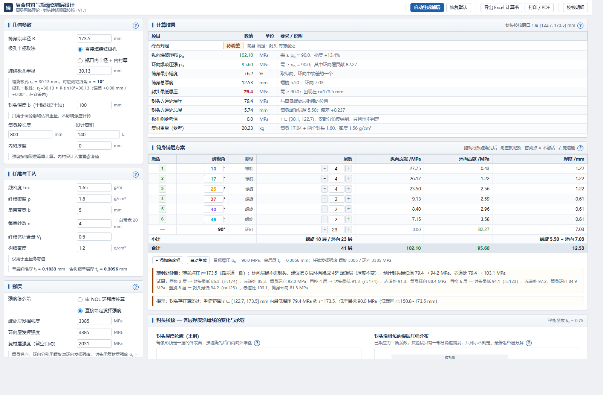
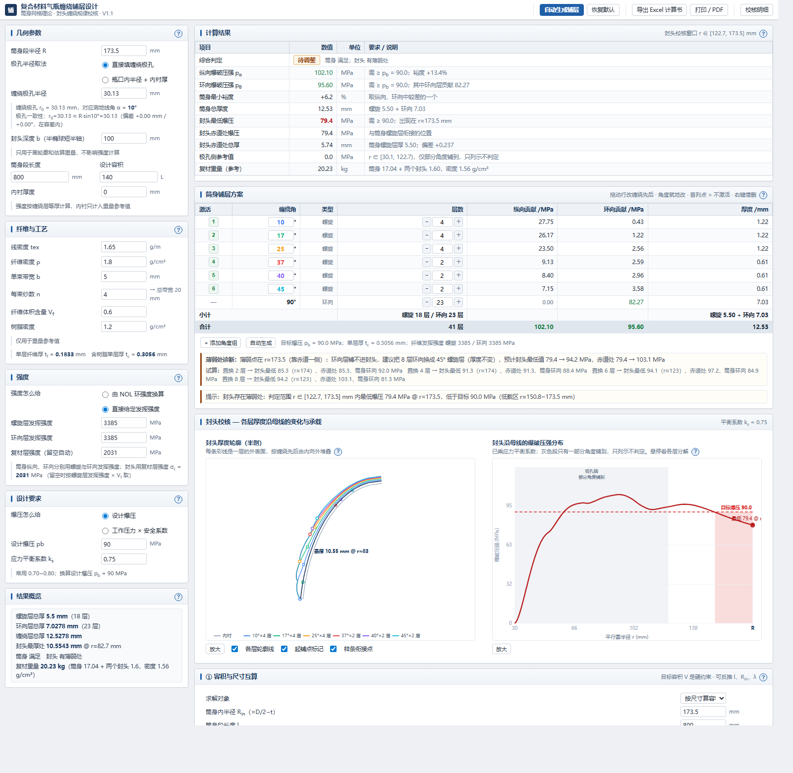
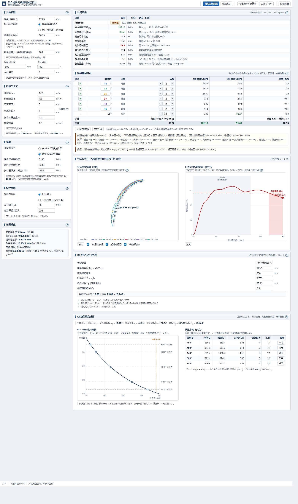
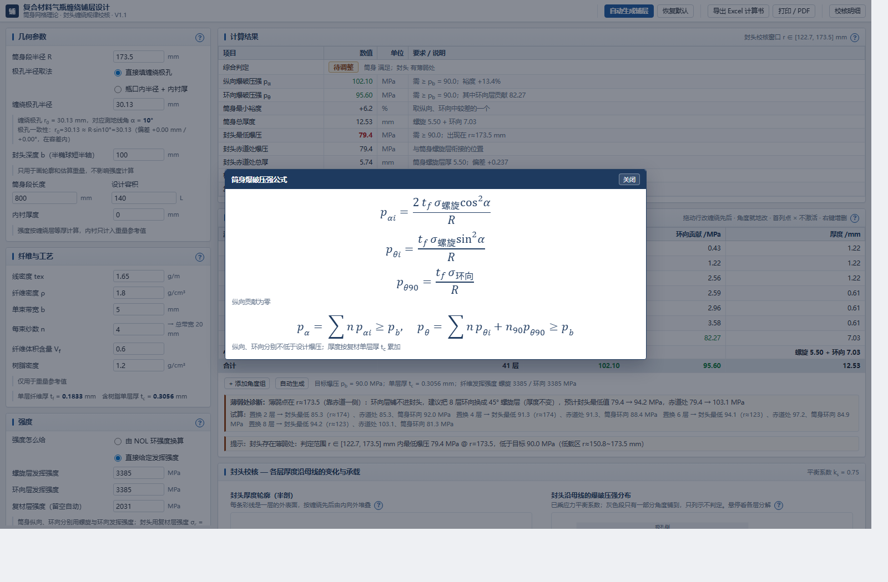
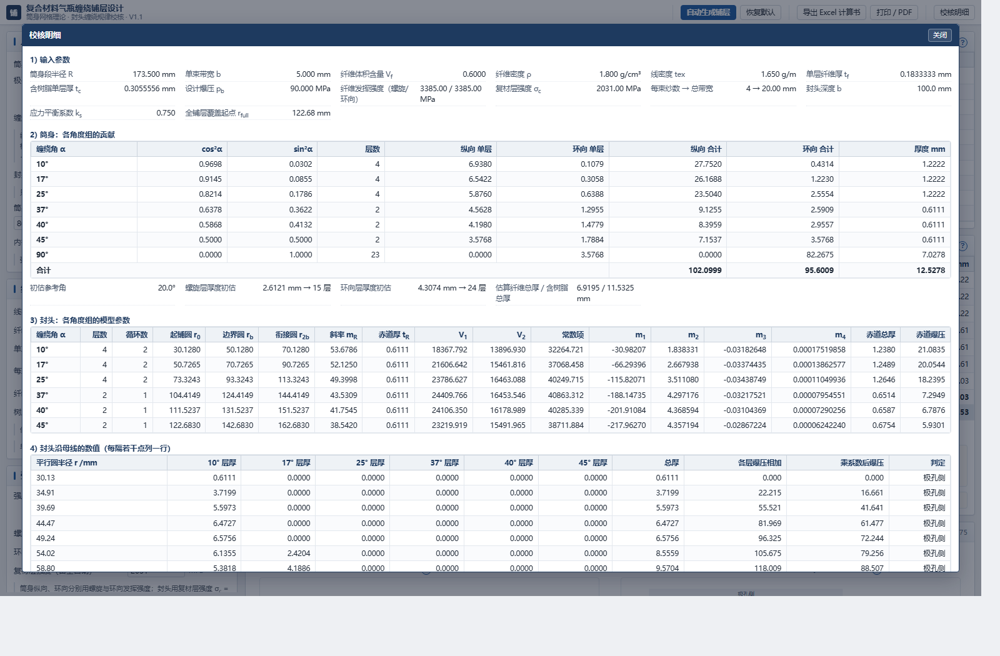

# 复合材料气瓶缠绕铺层设计系统 / Vessel Layup Designer

> **状态：代码与安装包暂时撤回。** 部分功能正在更新，后续会完全开放。如需交流或试用，请联系 **Z25150070@s.upc.edu.cn**。

面向 Ⅲ/Ⅳ 型储氢高压复合材料气瓶的缠绕铺层设计。把“课程讲义 + 两张 Excel 手工迭代”的流程，变成秒级、可视、可追溯的自动设计。

## 界面

<table>
<tr><td align="center" width="33.3%"> 主工作台：左侧输入，右侧计算结果与筒身铺层表</td><td align="center" width="33.3%"> 铺层方案编辑与封头校核双视图</td><td align="center" width="33.3%"> 容积互算与缠绕线型切点设计</td></tr>
<tr><td align="center" width="33.3%"> 公式弹窗：变量含义与公式</td><td align="center" width="33.3%"> 全参数逐格核验与明细审计</td><td width="33.3%"></td></tr>
</table>

## 功能一览

| 板块 | 能力 |
|---|---|
| 几何参数 | 筒身段半径 R、极孔半径取法（直接填缠绕极孔，或按瓶口内半径 + 内衬厚）、封头深度 b、筒身段长度、设计容积、内衬厚度 |
| 纤维与工艺 | 线密度 tex、纤维密度 ρ、单束带宽 b、每束纱数 n、纤维体积含量 Vf、树脂密度，自动推出单层纤维厚 tf、含树脂单层厚 tc 与总带宽 |
| 强度输入 | 模式 A 由 NOL 强度自算；模式 B 直接给定，螺旋与环向可分设 |
| 测地线 | 极孔半径与缠绕角双向互算，逐组扩孔并做极孔一致性校验 |
| 筒身校核 | 多角混合铺层的纵向与环向爆压、最小裕度、筒身总厚度 |
| 封头校核 | 按缠绕规律逐点求厚度分布与爆压分布，给出最低爆压所在半径区间与薄弱处提示 |
| 自动生成 | 先算筒身单角度层数并校核，只读输出结论；扩孔候选按两倍带宽衔接，可勾选任意组合 |
| 铺层表编辑 | 螺旋与环向共用一张有序表，每行选类型、填角度与层数，支持拖动换序、停用与增删；环向组不进入封头计算 |
| 几何板块 | 容积与尺寸互算、内胆纵剖面轮廓、线型缠绕切点校验、Ⅳ 型瓶接头尺寸与约束链 |
| 导出 | Excel 计算书（默认 16 张表，单元格为活公式）、方案 JSON 导入导出、打印 / PDF |

## 使用流程

1. 填几何参数、纤维与工艺、强度三组输入；
2. 点「自动生成铺层」，在扩孔候选表里选角度（默认跳选 8 组）；
3. 软件写入铺层表并分别校核筒身双向与封头逐点强度，未达标时给出一行补层建议；
4. 在铺层表里调整各组层数、角度、类型与顺序，满意后点「导出 Excel 计算书」或「打印 / PDF」。

顶部还有「恢复默认」（回到默认模板）与「校核明细」（逐格核验）。每个字段旁的「?」弹窗给出该参数的作用与公式。

## 注意

- 「缠绕极孔半径」填的是测地线极孔 r_cl，不是 Ⅳ 型瓶阀座通孔半径，两者在几何面板里并列显示。
- 输入参数与公式来自公开课件与基准算例，用于教学与预设计；工程签发须按 GB/T 35544 等标准与试验验证。

## 联系

非商业用途可直接使用；商业用途请先联系 **Z25150070@s.upc.edu.cn**。

使用中遇到问题，欢迎提 [Issue](https://github.com/IY724/vessel-layup-designer/issues)，或发邮件至 **Z25150070@s.upc.edu.cn**。

## 开发方式

本项目借助 AI 辅助编程（vibecoding）完成开发与文档整理。
